# Pipeline de la fábrica

```mermaid
flowchart LR
  s0["architect<br/>147 s"]:::ok
  s1["qa-unit<br/>1404 s"]:::ok
  s2["verify unit<br/>8 s"]:::fail
  s3["observability<br/>320 s"]:::ok
  s4["verify unit<br/>16 s"]:::ok
  s5["verify contract<br/>14 s"]:::ok
  s6["verify qa<br/>45 s"]:::fail
  s7["qa-unit<br/>75 s"]:::ok
  s8["verify unit<br/>9 s"]:::ok
  s9["verify contract<br/>8 s"]:::ok
  s10["verify qa<br/>24 s"]:::ok
  s11["qa-style<br/>63 s"]:::ok
  s0 --> s1
  s1 --> s2
  s2 --> s3
  s3 --> s4
  s4 --> s5
  s5 --> s6
  s6 --> s7
  s7 --> s8
  s8 --> s9
  s9 --> s10
  s10 --> s11
  classDef ok fill:#d4f4dd,stroke:#1e7b3a
  classDef fail fill:#fde2e2,stroke:#a12a2a
```

| # | Paso | Resultado | Segundos |
| --- | --- | --- | --- |
| 1 | architect | pasó | 147 |
| 2 | qa-unit | pasó | 1404 |
| 3 | verify unit | falló | 8 |
| 4 | observability | pasó | 320 |
| 5 | verify unit | pasó | 16 |
| 6 | verify contract | pasó | 14 |
| 7 | verify qa | falló | 45 |
| 8 | qa-unit | pasó | 75 |
| 9 | verify unit | pasó | 9 |
| 10 | verify contract | pasó | 8 |
| 11 | verify qa | pasó | 24 |
| 12 | qa-style | pasó | 63 |
