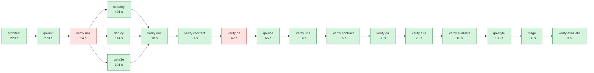

# Pipeline de la fábrica

| # | Paso | Resultado | Segundos |
| --- | --- | --- | --- |
| 1 | architect | pasó | 228 |
| 2 | qa-unit | pasó | 273 |
| 3 | verify unit | falló | 14 |
| 4 | security | pasó | 401 |
| 5 | deploy | pasó | 114 |
| 6 | qa-e2e | pasó | 191 |
| 7 | verify unit | pasó | 18 |
| 8 | verify contract | pasó | 21 |
| 9 | verify qa | falló | 42 |
| 10 | qa-unit | pasó | 65 |
| 11 | verify unit | pasó | 14 |
| 12 | verify contract | pasó | 15 |
| 13 | verify qa | pasó | 36 |
| 14 | verify e2e | pasó | 25 |
| 15 | verify evaluate | pasó | 15 |
| 16 | qa-style | pasó | 106 |
| 17 | triage | pasó | 358 |
| 18 | verify evaluate | pasó | 3 |
