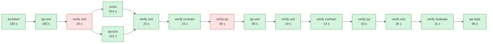

# Pipeline de la fábrica

| # | Paso | Resultado | Segundos |
| --- | --- | --- | --- |
| 1 | architect | pasó | 184 |
| 2 | qa-unit | pasó | 303 |
| 3 | verify unit | falló | 20 |
| 4 | costs | pasó | 514 |
| 5 | qa-e2e | pasó | 101 |
| 6 | verify unit | pasó | 20 |
| 7 | verify contract | pasó | 15 |
| 8 | verify qa | falló | 39 |
| 9 | qa-unit | pasó | 80 |
| 10 | verify unit | pasó | 19 |
| 11 | verify contract | pasó | 14 |
| 12 | verify qa | pasó | 43 |
| 13 | verify e2e | pasó | 26 |
| 14 | verify evaluate | pasó | 11 |
| 15 | qa-style | pasó | 96 |
