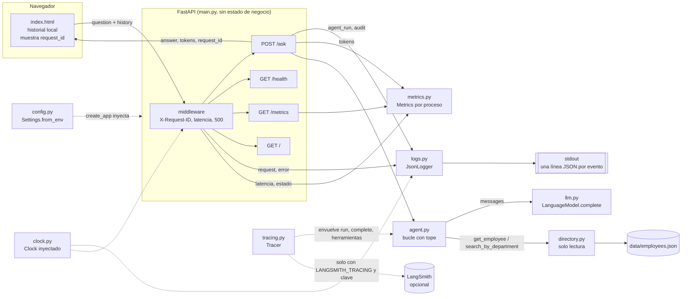
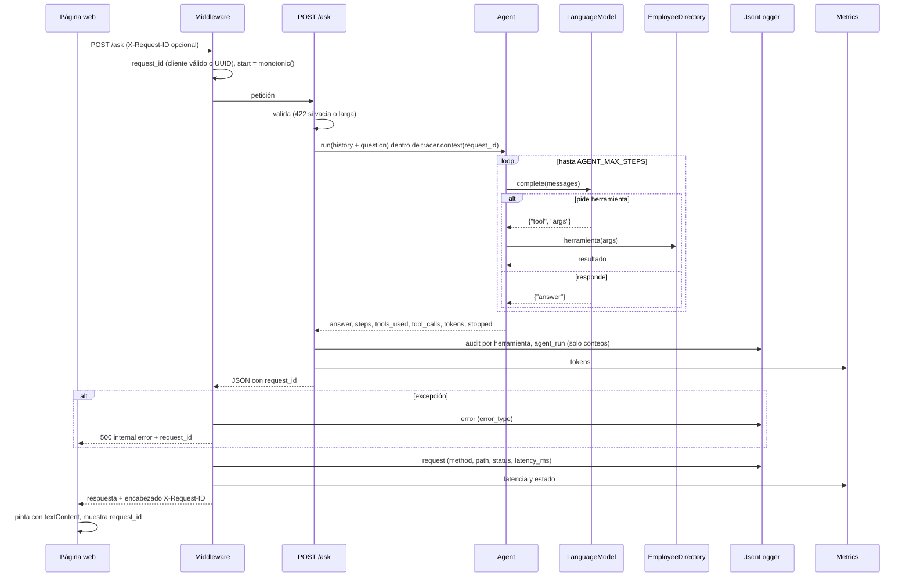

# Arquitectura del HR Assistant (sesiones 1 y 2)

El HR Assistant responde preguntas del personal de RH sobre empleados. Es una API FastAPI sin
estado con una página web, un solo agente con bucle con tope y un modelo detrás de una
interfaz. La sesión 2 agrega observabilidad: un id por petición, log JSON, métricas por
proceso y trazas opcionales en LangSmith.

## Componentes

## Secuencia de una pregunta

## Decisiones

- [0001 API sin estado con historial en el cliente](adr/0001-stateless-api.md)
- [0002 Modelo detrás de una interfaz e inyección de dependencias](adr/0002-model-interface-and-injection.md)
- [0003 Un solo agente con bucle con tope y protocolo JSON](adr/0003-bounded-agent-loop.md)
- [0004 Id por petición y log JSON sin datos personales](adr/0004-request-id-and-json-logs.md)
- [0005 Métricas en memoria por proceso](adr/0005-in-process-metrics.md)
- [0006 Trazas opcionales con LangSmith detrás de un Tracer](adr/0006-optional-langsmith-tracing.md)

## Configuración

| Variable | Por omisión | Validación |
| --- | --- | --- |
| `MODEL_PROVIDER` | `fake` | Solo `fake` |
| `AGENT_MAX_STEPS` | `3` | Entero mayor que 0 |
| `MAX_QUESTION_CHARS` | `2000` | Entero mayor que 0 |
| `EMPLOYEES_PATH` | `data/employees.json` | Relativo a `product/`; el archivo debe existir |
| `SERVICE_NAME` | `hr-assistant` | Texto no vacío |
| `SLO_P95_MS` | `2000` | Entero mayor que 0 |
| `LANGSMITH_TRACING` | `false` | `true` o `false`; sin `LANGSMITH_API_KEY` no se traza |
| `HIDE_INPUTS` / `HIDE_OUTPUTS` | `true` | `true` o `false` |

`LANGSMITH_API_KEY` se lee del entorno solo para saber si existe; no se guarda en `Settings`
ni se escribe en el log. Un valor inválido impide arrancar con un `ConfigError` claro.
