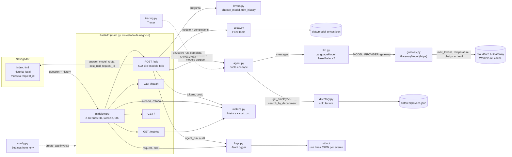
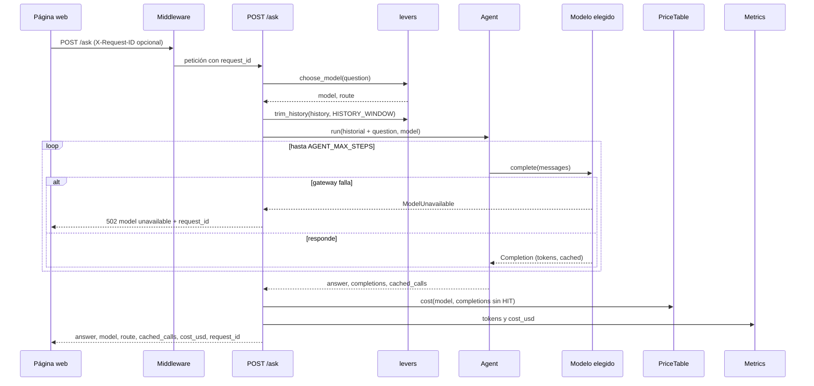

# Arquitectura del HR Assistant (sesiones 1, 2 y 3)

El HR Assistant responde preguntas del personal de RH sobre empleados. Es una API FastAPI sin
estado con una página web, un solo agente con bucle con tope y un modelo detrás de una
interfaz. La sesión 2 agrega observabilidad (id por petición, log JSON, métricas, trazas
opcionales). La sesión 3 agrega el modelo real (Workers AI vía AI Gateway) y cuatro palancas de
costo: enrutamiento, ventana de historial, tope de salida y caché, con el costo de cada
respuesta.

## Componentes

## Secuencia de una pregunta

## Decisiones

- [0001 API sin estado con historial en el cliente](adr/0001-stateless-api.md)
- [0002 Modelo detrás de una interfaz e inyección de dependencias](adr/0002-model-interface-and-injection.md)
- [0003 Un solo agente con bucle con tope y protocolo JSON](adr/0003-bounded-agent-loop.md)
- [0004 Id por petición y log JSON sin datos personales](adr/0004-request-id-and-json-logs.md)
- [0005 Métricas en memoria por proceso](adr/0005-in-process-metrics.md)
- [0006 Trazas opcionales con LangSmith detrás de un Tracer](adr/0006-optional-langsmith-tracing.md)
- [0007 Modelo real detrás de la interfaz, con cliente HTTP inyectado](adr/0007-gateway-model-behind-interface.md)
- [0008 Enrutamiento por regla y ventana de historial](adr/0008-rule-based-routing-and-history-window.md)
- [0009 Costo por respuesta y modelos simulados con precio](adr/0009-cost-per-answer-and-priced-fake-models.md)

## Configuración

| Variable | Por omisión | Validación |
| --- | --- | --- |
| `MODEL_PROVIDER` | `fake` | `fake` o `gateway` |
| `CF_ACCOUNT_ID`, `CF_GATEWAY_ID`, `CF_API_TOKEN` | vacía, `default`, vacía | Obligatorias y no vacías con `gateway`; el token no se muestra nunca |
| `MODEL_SMALL` | `@cf/meta/llama-3.1-8b-instruct-fast` | No vacío y con precio |
| `MODEL_LARGE` | `@cf/meta/llama-3.3-70b-instruct-fp8-fast` | No vacío y con precio |
| `ROUTING` | `true` | `true` o `false` |
| `ROUTER_MAX_CHARS` | `80` | Entero mayor que 0 |
| `HISTORY_WINDOW` | `6` | Entero mayor o igual a 0 |
| `MODEL_MAX_TOKENS` | `300` | Entero mayor que 0 |
| `MODEL_TEMPERATURE` | `0` | Decimal mayor o igual a 0 |
| `CACHE_TTL_SECONDS` | `0` | Entero mayor o igual a 0 (0: sin caché) |
| `PRICES_PATH` | `data/model_prices.json` | Relativo a `product/`; el archivo debe existir |
| `AGENT_MAX_STEPS` | `3` | Entero mayor que 0 |
| `MAX_QUESTION_CHARS` | `2000` | Entero mayor que 0 |
| `EMPLOYEES_PATH` | `data/employees.json` | Relativo a `product/`; el archivo debe existir |
| `SERVICE_NAME` | `hr-assistant` | Texto no vacío |
| `SLO_P95_MS` | `2000` | Entero mayor que 0 |
| `LANGSMITH_TRACING` | `false` | `true` o `false`; sin `LANGSMITH_API_KEY` no se traza |
| `HIDE_INPUTS` / `HIDE_OUTPUTS` | `true` | `true` o `false` |

Los secretos (`CF_API_TOKEN`, `LANGSMITH_API_KEY`) nunca se escriben en el log ni en
`.env.example`. Un valor inválido impide arrancar con un `ConfigError` claro.
