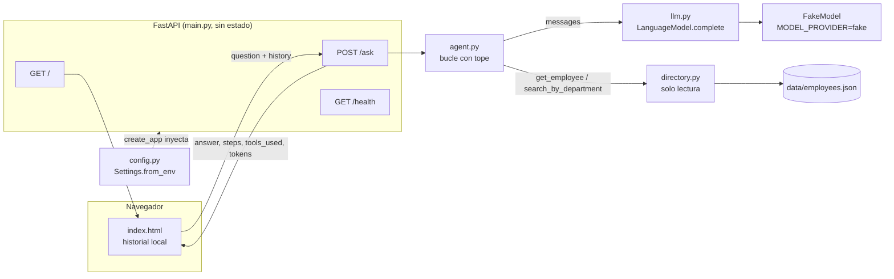
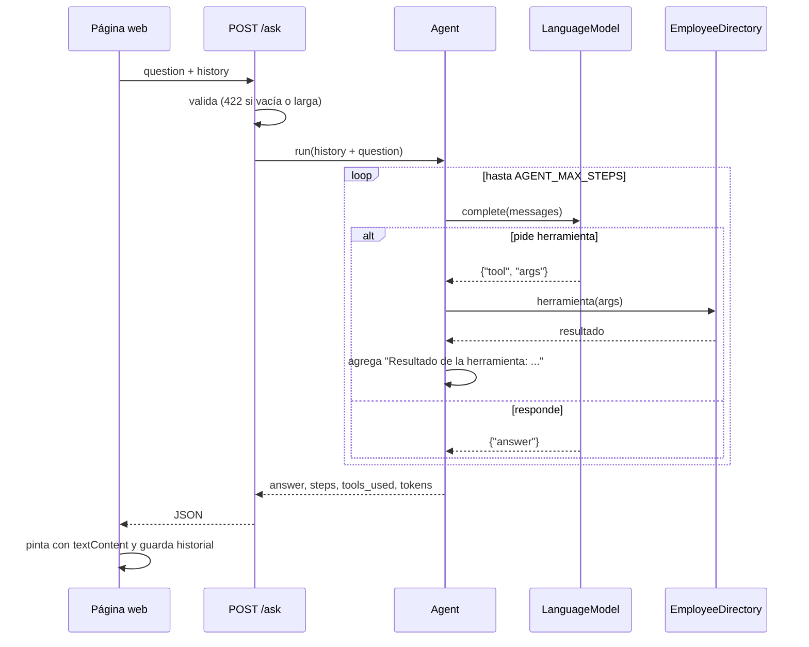

# Arquitectura del HR Assistant (sesión 1)

El HR Assistant responde preguntas del personal de RH sobre empleados. Es una API FastAPI sin
estado con una página web, un solo agente con bucle con tope y un modelo detrás de una interfaz.

## Componentes

## Secuencia de una pregunta

## Decisiones

- [0001 API sin estado con historial en el cliente](adr/0001-stateless-api.md)
- [0002 Modelo detrás de una interfaz e inyección de dependencias](adr/0002-model-interface-and-injection.md)
- [0003 Un solo agente con bucle con tope y protocolo JSON](adr/0003-bounded-agent-loop.md)

## Configuración

| Variable | Por omisión | Validación |
| --- | --- | --- |
| `MODEL_PROVIDER` | `fake` | Solo `fake` |
| `AGENT_MAX_STEPS` | `3` | Entero mayor que 0 |
| `MAX_QUESTION_CHARS` | `2000` | Entero mayor que 0 |
| `EMPLOYEES_PATH` | `data/employees.json` | Relativo a `product/`; el archivo debe existir |

Un valor inválido impide arrancar con un `ConfigError` claro.
